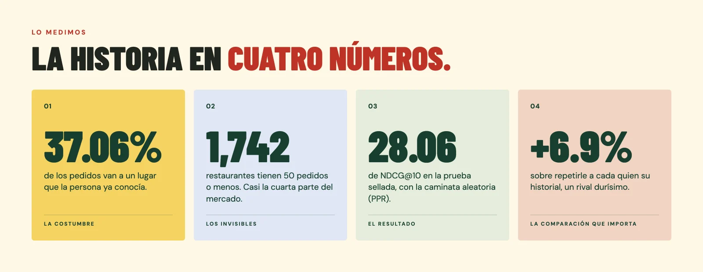
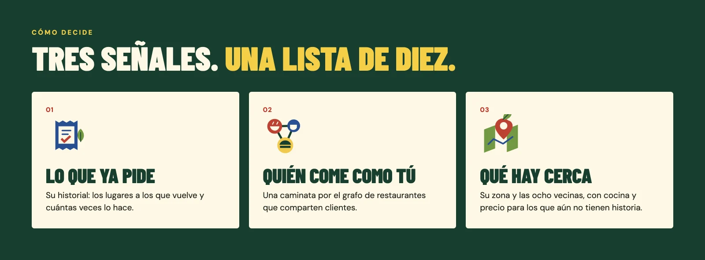
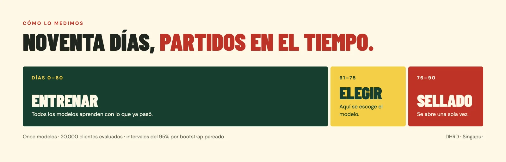
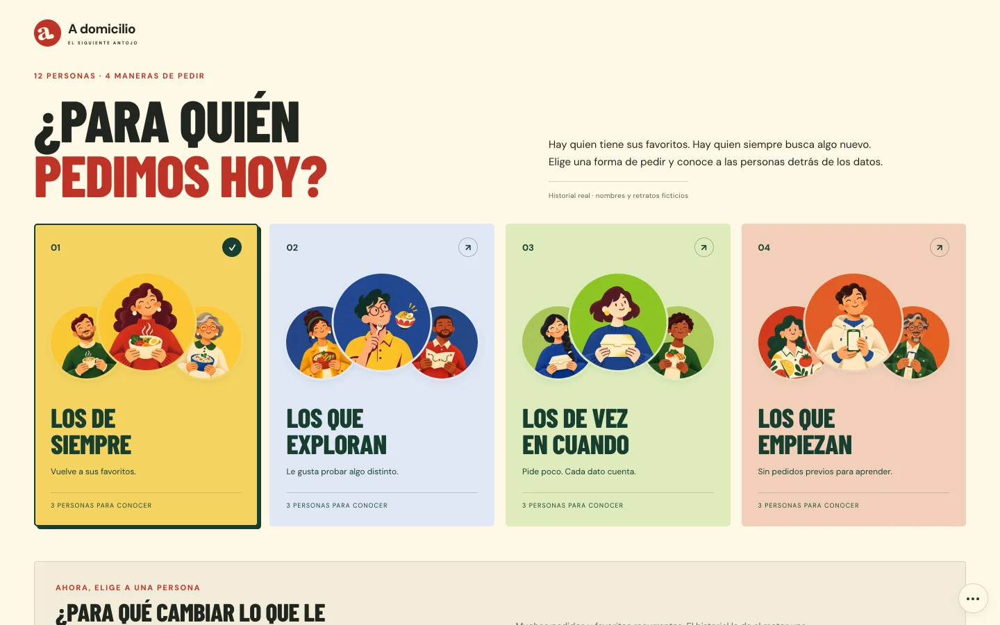
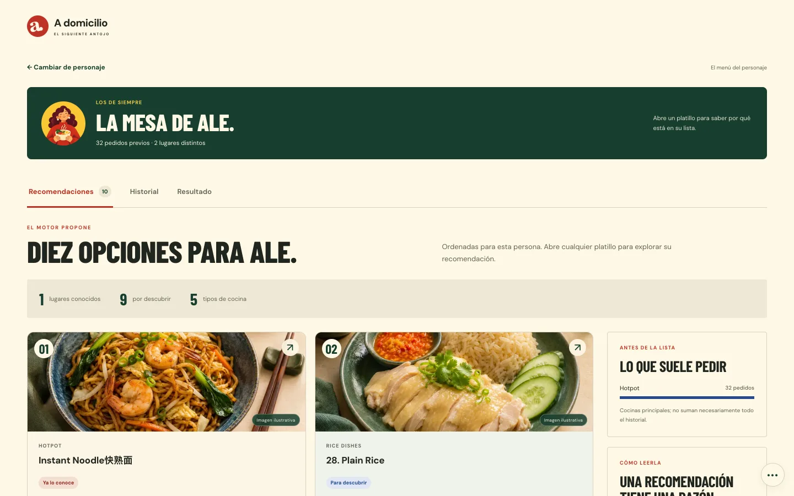
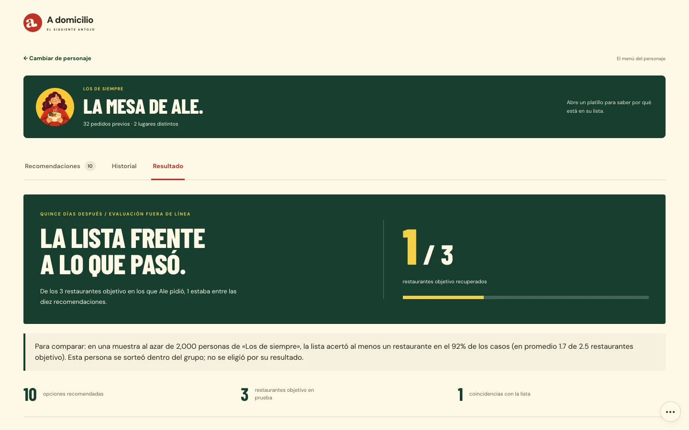
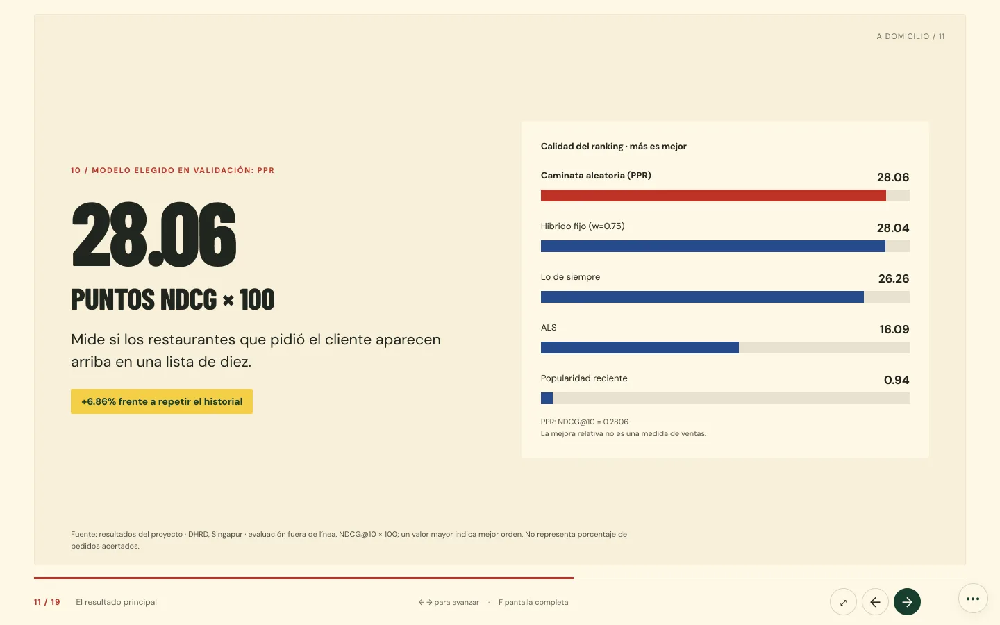
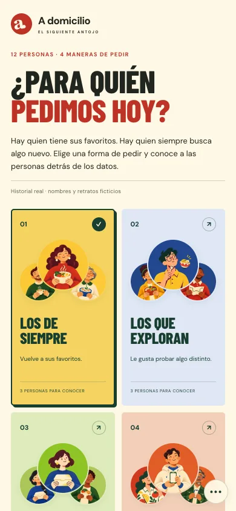
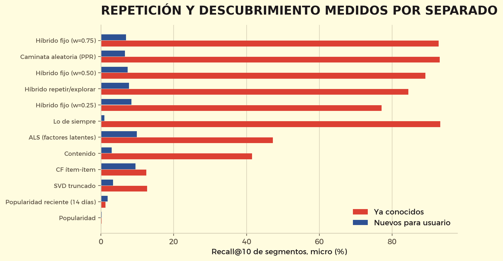

<p align="center">
  
</p>

<p align="center">
  <a href="https://diegomoctezuma.github.io/Sistema-Recomendacion/"><b>Probar la demo</b></a> ·
  <a href="https://diegomoctezuma.github.io/Sistema-Recomendacion/#1"><b>Ver la presentación</b></a> ·
  <a href="reporte/ProyectoFinal_MoctezumaRamirez.pdf"><b>Leer el reporte</b></a>
</p>

---

Abres la app. Le das scroll diez minutos. Y acabas pidiendo exactamente lo mismo de la semana pasada.

Cientos de restaurantes en la pantalla. Ninguno te conoce.

**A domicilio** es un motor de recomendación de restaurantes para apps de comida a domicilio. No es otra app de delivery: es el motor que usan las demás. Lo construimos y lo medimos con **dos millones de pedidos reales** del *Delivery Hero Recommendation Dataset* (DHRD), el único conjunto público de pedidos de comida a domicilio que existe.

## La historia en cuatro números

<p align="center">
  
</p>

**La costumbre.** Treinta y siete por ciento de los pedidos van a un lugar que la persona ya conocía. Un cliente con un solo pedido previo repite el 14% de las veces; uno con veinte o más, el 61%. La plataforma no le abre el mundo. Se lo cierra.

**Los invisibles.** 1,742 restaurantes tienen cincuenta pedidos o menos. ¿La solución obvia? Mostrar los más pedidos. Pero ocho de los veinte restaurantes más pedidos en entrenamiento no reciben un solo pedido en los quince días siguientes. El catálogo rota.

**El resultado.** La caminata aleatoria personalizada (PPR) logra **28.06 de NDCG@10**: casi siete por ciento arriba de simplemente repetirle a cada quien su historial, que en delivery es un rival durísimo. Esa es la comparación que importa.

## Cómo decide

<p align="center">
  
</p>

El motor arma un grafo de restaurantes que comparten clientes y camina por él desde los lugares que cada persona ya conoce. Las caminatas que vuelven seguido a un restaurante lo suben en la lista. Los candidatos salen de su zona y las ocho vecinas, así que nadie recibe un lugar al otro lado de la ciudad.

Cada recomendación trae su razón. Por ejemplo, la demo dice *"Por tus pedidos en «Rice 饭» (96% del puntaje)"*. La atribución es exacta y se verifica contra el puntaje antes de exportar.

## Cómo lo medimos

<p align="center">
  
</p>

Antes de enseñar un número, cómo lo medimos. Los noventa días se parten en el tiempo. Con los primeros sesenta se entrena. Con los siguientes quince se elige el modelo. Los últimos quince quedan sellados y se abren una sola vez.

La regla de selección se fijó antes de mirar: gana el mayor NDCG@10 de validación, pero si un modelo más simple no se distingue de él, se prefiere el más simple. Es lo más parecido a soltarlo en producción sin soltarlo.

| Modelo | NDCG@10 | Recall@10 | Ya conocidos | Nuevos para el cliente |
| --- | ---: | ---: | ---: | ---: |
| **Caminata aleatoria (PPR)** | **28.06** | **35.13%** | **93.06%** | **6.60%** |
| Híbrido fijo (w=0.75) | 28.04 | 35.28% | 92.72% | 6.87% |
| Lo de siempre | 26.26 | 30.83% | 93.18% | 1.00% |
| ALS (factores latentes) | 16.09 | 23.72% | 47.23% | 9.85% |
| Contenido | 12.37 | 17.70% | 41.52% | 2.95% |
| Popularidad reciente (14 días) | 0.94 | 1.71% | 1.26% | 1.83% |

<sub>Prueba sellada, días 76–90 · 20,000 clientes con historial · NDCG@10 × 100. Once modelos en total; la tabla completa está en <code>export/tabla_modelos.csv</code>.</sub>

Las diferencias traen intervalo del 95% por bootstrap pareado. La caminata supera a «Lo de siempre» por 1.80 puntos, con un intervalo de 1.65 a 1.95. Contra el mejor híbrido **empata**: 0.02 puntos, con un intervalo que cruza el cero. Por eso se queda la caminata: es la más simple.

## La demo

<p align="center">
  
</p>

Doce personas reales del conjunto de datos, en cuatro maneras de pedir: los de siempre, los que exploran, los de vez en cuando y los que empiezan. Cada grupo se definió solo con lo que pasó antes del corte, y dentro de cada grupo las personas se sortearon con una semilla fija, **sin** ver si acertábamos. No elegimos los que salen bien.

<table>
  <tr>
    <td width="50%"></td>
    <td width="50%"></td>
  </tr>
  <tr>
    <td><b>La lista.</b> Diez opciones para Ale, cada una con la razón por la que está ahí.</td>
    <td><b>Lo que pasó.</b> Ale fue a tres lugares distintos. Uno estaba en la lista. En su grupo, nueve de cada diez personas tuvieron al menos un acierto.</td>
  </tr>
</table>

<table>
  <tr>
    <td width="70%"></td>
    <td width="30%"></td>
  </tr>
  <tr>
    <td>La presentación vive dentro de la misma página: 19 diapositivas, con flechas y pantalla completa con <kbd>F</kbd>.</td>
    <td>También funciona en el teléfono.</td>
  </tr>
</table>

<sub>Nombres y retratos ficticios; historiales y resultados reales.</sub>

## Lo que no prueba

<p align="center">
  
</p>

La objeción honesta: la caminata recupera el **93.06%** de los lugares conocidos, pero solo el **6.60%** de los nuevos. El mejor modelo en descubrir, ALS, llega a 9.85%, pero su NDCG cae a 16.09. Descubrir sigue siendo difícil. Lo decimos.

- **Clientes sin historial.** Son el 15.20% de los pedidos de prueba. Ahí el motor cae a la popularidad reciente de toda la ciudad y acierta poco: 0.84% de recall. Es el peor caso.
- **Restaurantes con poca historia.** La caminata recupera el 13.06% de sus pedidos, el mejor resultado entre los once modelos, pero lejos de resolverlo.
- **Es una evaluación fuera de línea.** Mide si la lista contiene los lugares a los que la persona fue después. No mide ventas ni qué habría pasado si la lista se le mostraba.
- **Los datos son de Singapur.** Rappi, DiDi y Uber Eats no publican pedidos. Lo que se transfiere es el método.
- **El producto es una propuesta.** La suscripción, la API y el piloto con una app local son el siguiente paso, no algo construido.

## Qué hay en el repositorio

| Ruta | Qué es |
| --- | --- |
| [`01_motor_recomendacion.ipynb`](01_motor_recomendacion.ipynb) | El análisis completo: auditoría de datos, Apriori y FP-Growth, PrefixSpan, PageRank y HITS, comunidades con Louvain, once recomendadores y su evaluación. |
| [`02_export_demo.py`](02_export_demo.py) | Sortea a las personas de la demo y exporta sus listas a `web/demo.json`. |
| [`export/`](export) | Resultados en CSV y `resultados.json`, la fuente de todas las cifras. |
| [`figs/`](figs) | Las figuras del notebook. |
| [`web/`](web) | La demo y la presentación. Se publica sola en GitHub Pages con cada cambio en esta carpeta. |
| [`reporte/`](reporte) | El reporte final en PDF y Word, y el script que lo regenera. |

## Cómo correrlo

**1. Los datos.** Descarga el [DHRD](https://github.com/deliveryhero/dh-reco-dataset) (1.4 GB) y déjalo en `Data/DHRD/`, con los archivos de Singapur en `Data/DHRD/data_sg/`. El notebook busca esa carpeta desde el proyecto hacia arriba; si está en otro lado, define `DHRD_DIR`.

**2. El entorno.** Python 3.13:

```bash
pip install -r requirements.txt
```

**3. El análisis.** Corre `01_motor_recomendacion.ipynb` de principio a fin. Escribe `export/` y `figs/`. La última ejecución completa tomó unos ocho minutos en una máquina con dos núcleos y sin GPU.

**4. La demo.**

```bash
python3 02_export_demo.py        # escribe web/demo.json
python3 web/actualizar_datos.py  # renueva web/contenido.js
cd web && python3 -m http.server 8000
```

Abre `http://localhost:8000`.

> [!IMPORTANT]
> `02_export_demo.py` repite a propósito parámetros y funciones del notebook: alfa de la caminata, poda del grafo, geohash y top-k determinista. Si cambias alguno en el notebook, cámbialo también en el script y vuelve a exportar `web/demo.json`.

**5. El reporte.** Los pasos están en [`reporte/LEEME.md`](reporte/LEEME.md).

## Equipo

**Diego Rafael Moctezuma Ramírez** y **Gonzalo Sebastián Mera Montiel**.
Datos Masivos II · Facultad de Estudios Superiores Acatlán, UNAM · Profesora Alondra Vanianinetl Berzunza Rodríguez.

<p align="center"><sub>Repetir ya está resuelto. Descubrir es el negocio.</sub></p>
